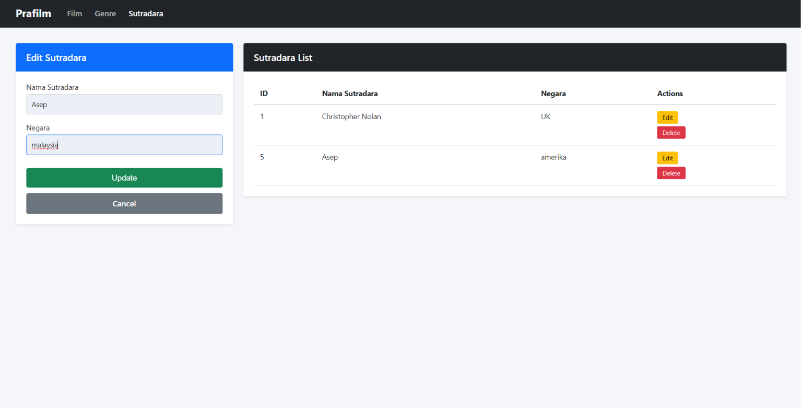
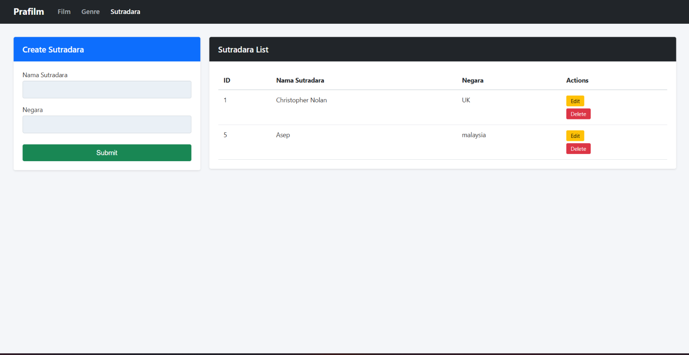
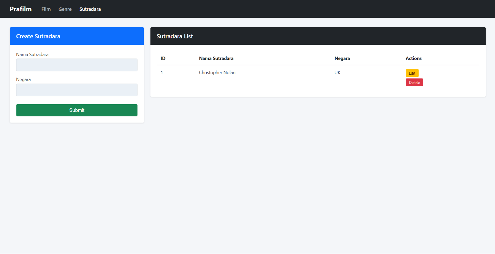

# TP8DPBO2526C1 

# Janji

Saya Raffi Akbar Ardiansyah dengan NIM 2511604 mengerjakan Tugas Praktikum 8 dalam mata kuliah Desain dan Pemrograman Berorientasi Objek untuk keberkahan-Nya maka saya tidak melakukan kecurangan seperti yang telah dispesifikasikan. Aamiin.

Program aplikasi web sederhana berbasis PHP native dan MySQL untuk mengelola data film, genre, dan sutradara dengan menerapkan pola arsitektur Model-View-Controller (MVC).

## 1. Desain Program

Program ini dirancang menggunakan konsep pemrograman berorientasi objek (OOP) dan memisahkan logika aplikasi ke dalam pola arsitektur MVC (Model-View-Controller) agar struktur kode rapi, modular, dan mudah dipelihara.

### A. Struktur folder dan Arsitektur (MVC)

```
├── Dokumentasi/                # Tangkapan layar dokumentasi aplikasi
├── config.php                  # Konfigurasi koneksi database
├── db_bioskop                  # database yang dipakai        
├── index.php                   # Entry point utama (Halaman daftar Film)
├── genre.php                   # Entry point untuk halaman Genre
├── sutradara.php               # Entry point untuk halaman Sutradara
│
├── controllers/                # Pengendali alur antara Model dan View
│   ├── FilmController.php      
│   ├── GenreController.php     
│   └── SutradaraController.php 
│
├── models/                     # Kelas yang berinteraksi langsung dengan database
│   ├── DB.php                  # Kelas utama untuk koneksi database mysqli
│   ├── Film.php                # Model CRUD tabel film
│   ├── Genre.php               # Model CRUD tabel genre
│   └── Sutradara.php           # Model CRUD tabel sutradara
│
├── templates/                  # Berkas HTML murni beserta CSS (UI/UX)
│   ├── genre.html              
│   ├── index.html              # Template HTML untuk halaman Film
│   └── sutradara.html          
│
└── views/                      # Kelas yang menyuntikkan data ke file template
    ├── FilmView.php            
    ├── GenreView.php           
    ├── SutradaraView.php       
    └── Template.php            # Mesin pemroses yang mengganti placeholder teks dengan HTML dinamis
```

**1. Model (`models/`)**
*   Bertanggung jawab atas pengelolaan data dan interaksi langsung dengan basis data MySQL.
*   `DB.php`: Kelas dasar pembungkus koneksi basis data (`mysqli`) yang menyediakan metode koneksi dan eksekusi query (`execute`, `close`).
*   `Sutradara.php`: Mewarisi kelas `DB`, menangani operasi CRUD untuk tabel sutradara.
*   `Genre.php`: Mewarisi kelas `DB`, menangani operasi CRUD untuk tabel genre.
*   `Film.php`: Mewarisi kelas `DB`, menangani operasi CRUD untuk tabel film serta penggabungan (`JOIN`) dengan tabel sutradara dan genre untuk mengambil nama masing-masing entitas.

**2. View (`views/` & `templates/`)**
*   Bertanggung jawab atas penyajian data ke dalam antarmuka visual (UI) pengguna.
*   `Template.php`: Mesin template sederhana yang membaca berkas HTML statis dan mengganti *placeholder* (seperti `DATA_FILM`, `OP_SUTRADARA`, `DATA_GENRE`, dll.) dengan konten HTML dinamis (baris tabel atau opsi dropdown).
*   `SutradaraView.php`: Menyiapkan tampilan daftar sutradara dan menyuntikkannya ke template.
*   `GenreView.php`: Menyiapkan tampilan daftar genre dan menyuntikkannya ke template.
*   `FilmView.php`: Menyiapkan tampilan daftar film dan opsi *dropdown* (sutradara dan genre) untuk form, lalu menyuntikkannya ke template.
*   `templates/index.html`, `templates/sutradara.html`, & `templates/genre.html`: Berkas template HTML statis berdesain *card-layout* yang menjadi kerangka tampilan halaman tabel dan formulir.

**3. Controller (`controllers/`)**
*   Bertindak sebagai pengendali utama logika bisnis dan penghubung antara Model dan View.
*   `SutradaraController.php`: Mengontrol alur data sutradara (menampilkan daftar, memproses penambahan, serta penghapusan data).
*   `GenreController.php`: Mengontrol alur data genre (menampilkan daftar, memproses penambahan, serta penghapusan data).
*   `FilmController.php`: Mengontrol alur data utama film (mengambil data dari model Film, Sutradara, dan Genre, lalu menyajikannya ke tampilan terkait).

**4. Router / Entry Point (`index.php`, `sutradara.php`, `genre.php`)**
*   Berfungsi sebagai gerbang utama (*entry point*) aplikasi web untuk masing-masing halaman.
*   Mengecek ada tidaknya *request* POST (untuk *submit* data) atau parameter GET (untuk aksi `hapus`), kemudian mengarahkan permintaan ke metode yang tepat pada Controller.

### B. Struktur Basis Data (Relasi Antar Tabel)

Basis data `db_bioskop` terdiri dari tiga tabel yang saling berelasi:
*   `sutradara`: Menyimpan data sutradara dengan kolom `id` (Primary Key), `nama_sutradara`, dan `negara`.
*   `genre`: Menyimpan data kategori film dengan kolom `id` (Primary Key) dan `nama_genre`.
*   `film`: Menyimpan data film dengan kolom `id` (Primary Key), `judul_film`, `tahun_rilis`, `id_sutradara` (Foreign Key), dan `id_genre` (Foreign Key).
*   **Relasi**: Kolom `film.id_sutradara` merujuk pada `sutradara.id`, dan `film.id_genre` merujuk pada `genre.id`. Keduanya menggunakan aturan `ON DELETE CASCADE` (jika data sutradara/genre dihapus, film yang terhubung akan ikut terhapus).

## 2. Alur Cara Kerja Program

### A. Alur Siklus Permintaan (Request Lifecycle)

```text
[ Pengguna / Browser ]
          │ (Request URL: submit post / hapus get)
          ▼
   [ Entry Point PHP ] ──(Routing)──► [ Controller ]
                                           │       ▲
                          (Query Data)     │       │ (Data Array/Result)
                          ▼                ▼       │
                     [ Model ] ◄───► [ Database MySQL ]
                          │
                          └────────(Kirim Data)────┐
                                                   │
                                                   ▼
                                          [ View & Template ]
                                                   │
                                                   ▼ (Render HTML)
                                         [ Tampilan Browser ]
```

1.  **Permintaan Pengguna (Request):** Pengguna mengakses URL tertentu di browser (misal: membuka `index.php` atau mengirim form penambahan film).
2.  **Pemeriksaan Rute (Routing):** Berkas *entry point* (seperti `index.php`) memeriksa ketersediaan variabel bawaan PHP (`$_POST['submit']` atau `$_GET['hapus']`) untuk menentukan aksi yang dipanggil di Controller.
3.  **Pemrosesan pada Controller:**
    *   Jika memuat halaman awal: Controller meminta data ke Model, lalu mengirimkan hasilnya ke View.
    *   Jika menerima form (POST): Controller memanggil fungsi penambahan pada Model, lalu mengalihkan (*redirect*) kembali ke halaman awal.
    *   Jika menerima perintah hapus (GET): Controller meneruskan parameter ID ke fungsi hapus di Model, lalu mengalihkan (*redirect*) kembali.
4.  **Penyajian Tampilan (Render View):** View melooping data dari Model menjadi tag HTML (`<tr>` atau `<option>`), menyuntikkannya ke dalam berkas `Template.php` untuk mengganti *placeholder*, dan mencetak keluaran visual final ke layar pengguna.

### B. Alur Kerja Fitur CRUD

1.  **Menampilkan Data (Read):**
    *   Pengguna membuka halaman `index.php`.
    *   `FilmController` memanggil `getFilm()` dari model `Film` (yang melakukan `SELECT JOIN` ke tabel `sutradara` dan `genre`).
    *   Data dikirim ke `FilmView` dan dirender ke dalam tabel.
2.  **Menambah Data (Create):**
    *   Pengguna mengisi form di panel kiri dan menekan *Submit*.
    *   Data formulir ditangkap dalam array `$_POST` dan diteruskan ke Controller (`add($data)`).
    *   Controller menyuruh Model menjalankan query `INSERT INTO`.
    *   Halaman di-refresh ke status default (menghindari duplikasi form resubmission).
3.  **Mengubah Data (Update):**
    *   Pengguna menekan tombol kuning *Edit* pada baris data tabel yang ingin diubah.
    *   Aksi ini mengarahkan URL dengan parameter `edit` (contoh: `index.php?edit=1`).
    *   Controller menangkap ID tersebut dan mengambil data terkait melalui Model, lalu menampilkannya kembali ke dalam formulir.
    *   Pengguna memperbarui data lalu menekan tombol *Update*.
    *   Controller memanggil metode `update` pada Model untuk menjalankan query `UPDATE`, kemudian me-refresh halaman.
4.  **Menghapus Data (Delete):**
    *   Pengguna menekan tombol merah *Delete* pada baris data tertentu.
    *   Aksi ini mengarahkan URL dengan parameter `hapus` (contoh: `index.php?hapus=1`).
    *   Controller menangkap nilai ID dan memanggil Model untuk menjalankan perintah `DELETE FROM ... WHERE id=...`.
    *   Data sukses terhapus dari basis data dan tabel langsung diperbarui.

## 3. Dokumentasi

### A. Fitur Kelola Sutradara (`sutradara.php`)

1. **Tambah Sutradara**
   * *Pengisian Formulir Tambah Sutradara:*
     
   * *Data Sutradara Berhasil Ditambahkan ke Tabel:*
     

2. **Edit Sutradara**
   * *Formulir Edit Terisi Data Sutradara yang Dipilih:*
     
   * *Data Sutradara Berhasil Diperbarui:*
     

3. **Hapus Sutradara**
   * *Data Sutradara Berhasil Dihapus dari Tabel:*
     

---

### B. Fitur Kelola Genre (`genre.php`)

1. **Tambah Genre**
   * *Pengisian Formulir Tambah Genre:*
     
   * *Data Genre Berhasil Ditambahkan ke Tabel:*
     

2. **Edit Genre**
   * *Formulir Edit dan Pembaruan Data Genre:*
     

3. **Hapus Genre**
   * *Data Genre Berhasil Dihapus dari Tabel:*
     

---

### C. Fitur Kelola Film (`index.php`)

1. **Tambah Film**
   * *Pengisian Formulir Tambah Film (Relasi Dropdown Sutradara & Genre):*
     
   * *Data Film Berhasil Ditambahkan ke Tabel:*
     

2. **Edit Film**
   * *Formulir Edit Terisi Data Film yang Dipilih:*
     
   * *Data Film Berhasil Diperbarui:*
     

3. **Hapus Film**
   * *Data Film Berhasil Dihapus dari Tabel:*
     
